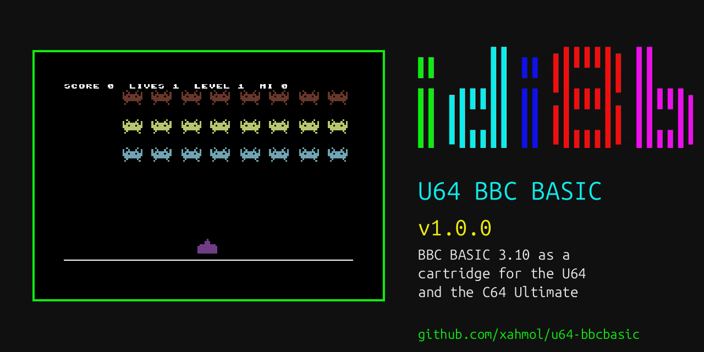

# U64 BBC BASIC

BBC BASIC 3.10 for the Ultimate 64 and C64 Ultimate, as a cartridge, with a
BBC-style MOS (machine operating system) on top of the C64 KERNAL, and
`*` commands for the Ultimate's features.



**Version 1.0.0.** The interpreter is the original BBC BASIC 3.10,
unchanged, running at the Ultimate's turbo speed. Around it:

- **Screen and graphics:** the BBC's screen modes, teletext MODE 7, Upic
  Lite (square pixels at 64 MHz) and Upic full pictures (384 x 256, every
  pixel its own colour), C64 bitmap modes, sprites and a sprite editor,
  fast `*` graphics commands, PETSCII mode.
- **Sound:** `SOUND` and `ENVELOPE` on up to 8 SIDs (24 voices) with
  instruments and a song player; Ultimate Audio sample effects and
  ProTracker MOD music in the background.
- **Files:** the Ultimate's drives, an REU RAM disk (`/REU`), DFS-style
  commands, disk images, and a file browser (`*BROWSE`, or F1 at the
  prompt).
- **Network:** network channels, HTTP requests (GET, POST, PUT, DELETE,
  headers, status codes) and JSON.
- **The Ultimate:** drives, clock, settings, turbo, the REU as storage.
- **Editing:** a line editor with history and BBC copy editing, and a
  built-in help system (`*HELP`) covering every keyword and command.

The **user manual** is [docs/manual](docs/manual/README.md), also as
[one PDF](docs/manual/U64_BBC_BASIC_MANUAL.pdf); the changes
per version are in [CHANGELOG.md](CHANGELOG.md).

**Compatibility.** The aim is that BBC BASIC *programs* run: the
language, and the behaviour of the VDU, graphics, sound and file
statements. It is not a BBC Micro emulator: the memory map, the BBC
hardware, the MOS internals and BBC machine code are not reproduced, so
programs that poke the machine or call BBC machine code will not work.

## Download

The cartridge images, their `.cfg` files, the demos, the manual and the VS
Code extension are in the
[releases](https://github.com/xahmol/u64-bbcbasic/releases). Building from
source is described below.

## Videos

Five videos, all captured from an Ultimate 64 Elite II's video and audio
streams ([playlist](https://www.youtube.com/playlist?list=PLWExM0Ai4nOY)):

1. [Introduction](https://www.youtube.com/watch?v=BChxLcacPqM): why it
   exists, typing and running BBC BASIC, speed, the line editor, `*HELP`,
   VS Code
2. [Graphics](https://www.youtube.com/watch?v=gWtzLSlktU4): the BBC
   modes, Upic, teletext, sprites, the sprite editor, maps, PETSCII
3. [Sound and music](https://www.youtube.com/watch?v=AHoB8xzAdME): BBC
   `SOUND`, 24 SID voices, the song player, MODs and samples, speech
4. [Files, the Ultimate and the network](https://www.youtube.com/watch?v=c20G7vHwpCI):
   the file browser, the REU RAM disk, HTTP, a teletext service
5. [The demos](https://www.youtube.com/watch?v=sZd4QJHff_s): the
   showcase, Eric Schraf's programs, BBC BASIC classics

## Cartridges

| File | Type | For |
|---|---|---|
| `u64bbc-tmb.crt` | Protovision TwoMegabyter (CRT type 87) | Ultimate 64 / C64 Ultimate: UCI, REU, Ultimate Audio and turbo all usable |
| `u64bbc-ef.crt` | EasyFlash, subtype 1 | VICE, and as a fallback (no Ultimate Audio; the firmware moves UCI to `$DE1C`) |

Copy the `.cfg` with the same name next to the `.crt`. When the cartridge
is started from the Ultimate's file browser (firmware 3.15+), it switches
on the Command Interface, the REU, the Ultimate Audio mapping and the U64
turbo registers, and sets up 8 UltiSIDs for sound (as Heartbeat
Soundtracker does: UltiSID 1 at `$D400`, UltiSID 2 at `$D420`, each split
four ways; SIDs in the sockets keep their addresses and play along). The
settings are loaded into memory only, not saved to flash. A 16 MB REU is
expected.

## Using it

- Letters type in capitals (BBC CAPS LOCK on); Shift gives lower case;
  Shift+C= switches CAPS LOCK.
- The ASCII characters the C64 keyboard lacks: `\` = £, `^` = ↑, `_` = ←,
  `|` = Shift+£, `~` = Shift+↑, `{` = Shift++, `}` = Shift+-,
  `` ` `` = Shift+@.
- RUN/STOP is ESCAPE.
- Input lines can be up to 238 characters, edited in place, with the
  last 127 lines on the cursor keys and BBC copy editing (`*EDIT C64`
  gives the C64 screen editor back).
- `PAGE` = &1D00 (as a BBC Micro with ADFS), `HIMEM` = &8000: 25.75K for
  programs; &0800-&1CFF holds the sound engine (`*SOUND NONE` frees it).
- MOS entry points: `OSWRCH` = &C7EE, `OSBYTE` = &C7F4, `OSWORD` = &C7F1,
  `OSCLI` = &C7F7, … (BBC low bytes, page &C7). The RAM vectors are at
  &0200, as on the BBC.
- Files (see `*HELP FILES`): `LOAD`, `SAVE`, `CHAIN`, two open channels
  (`OPENIN`, `OPENOUT`, `OPENUP`, `BGET#`, `BPUT#`, `PRINT#`, `INPUT#`,
  `PTR#`, `EXT#`, `EOF#`), on the Ultimate's drives and on `/REU`.
- The file browser (`*BROWSE`, or <kbd>F1</kbd> on an empty line at the
  prompt) has the keys of UBoot64-v2's: cursor keys to move, enter and
  leave folders, P/U page, T/E top/end, `/` the root; RETURN opens by
  type (CHAINs a program, shows a PETSCII or Upic file, plays a MOD or
  WAV, mounts a disk image); SPACE marks, C/X/V copy, cut and paste
  (folders too), D deletes, R renames, N makes a folder, L lists a file.
- `*HELP` covers every BASIC keyword, command and topic: `*HELP KEYWORDS`,
  `*HELP COMMANDS`, `*HELP TOPICS`; `*HELP LIMITS` lists what this BASIC
  can and cannot do.

## Demos

Installed with the cartridges (`make deploy`), tokenised, in `demos/`:

| Folder | Start | Contents |
|---|---|---|
| `showcase` | `SHOW` | a timed show of graphics and music, SID first, then a MOD on Ultimate Audio |
| `gfx` | `GFXDEMO` | a tour of the screen modes: BBC, C64, teletext, Upic, sprites |
| `archbas` | `SCHRAF`, `XMAS` | Eric Schraf's graphics programs; a Christmas tree |
| `sprites` | `BALLS`, `INVADERS` | multiplexed sprites; a small game (keys or joystick) |
| `music` | `MUSIC` | the song player with classical pieces on the SIDs |
| `sound` | `SID24` | 24 SID voices |
| `audio` | `AUDIO` | Ultimate Audio sample effects and MOD music |
| `net` | `U64TEXT` | a Ceefax-style service in MODE 7 over HTTP and JSON: weather, blog, news, the ISS |
| `petscii` | `PETSCII` | the PETSCII mode, with the idi8b logo |
| `classics` | `HANOI`, `ANIMAL`, … | classic BBC BASIC programs |

`*DIR /SD/idi8b/u64bbcbasic/demos/showcase` and `CHAIN "SHOW"`, or
<kbd>F1</kbd> and pick a program in the browser.

## Programming from a PC or an AI agent

- **VS Code:** the extension in `vscode/` (`make vscode` builds
  `build/u64-bbcbasic.vsix`) runs `.bas` files on the machine with
  Ctrl+F5, shows output and puts run-time errors on the source line.
- **Command line:** `tools/u64remote.py run prog.bas` (JSON with `--json`).
- **AI coding agents:** the MCP server `tools/u64mcp.py` (registered in
  `.mcp.json`); see [docs/AI_AGENTS.md](docs/AI_AGENTS.md).

## Building from source

Requirements: [MADS](https://github.com/tebe6502/Mad-Assembler) 2.1.x
(build with FreePascal: `fpc -Mdelphi -vh -O3 mads.pas`), Python 3, GNU
make, `patch`. VICE (`x64sc`) and Node.js (`npx`) for the tests.

```
git clone --recurse-submodules https://github.com/xahmol/u64-bbcbasic
cd u64-bbcbasic
make                # build/u64bbc-tmb.crt, build/u64bbc-ef.crt and .cfg
make compare-core   # BBC BASIC 3.10 still identical to the reference ROM
make vice           # run in VICE
make e2e            # end-to-end tests (tests/e2e/README.md)
make deploy         # install on the Ultimate (below)
```

Put the Ultimates' IP addresses in `.env` (`ULTIP1 = ...`, `ULTIP2 = ...`)
for `make deploy` and the tests, and the drive to install on (`ULTDRV1 =
SD`, `ULTDRV2 = ...`; default `USB0`). `make deploy` puts the cartridges
and their `.cfg` files in `/<drive>/idi8b/u64bbcbasic/` and the demos in
its `demos/` folder. A second Ultimate is skipped when it does not
answer.

The design is described in [docs/ARCHITECTURE.md](docs/ARCHITECTURE.md)
(banks, memory maps) and the `docs/DESIGN_*.md` documents; the decisions
and what comes next in [docs/PLAN.md](docs/PLAN.md).

## Credits and licences

- BBC BASIC © 1982/1983 Acorn Computers and Sophie Wilson.
- Annotated MADS source: Ivo van Poorten,
  [ivop/bbc-basic](https://github.com/ivop/bbc-basic), based on
  J.G. Harston's source reconstruction
  ([mdfs.net](https://mdfs.net/Software/BBCBasic/)). Used as a submodule;
  this project only adds a build target (`src/basic/u64-target.patch`).
- The MOS design follows Ivo van Poorten's
  [Atari port](https://github.com/ivop/atari-bbc-basic).
- Ultimate knowledge: [ultimate-uci-oscar64](https://github.com/xahmol/ultimate-uci-oscar64).
- The MOD player is ModPlayer_16k by Freshness (6510nl),
  [CSDb release 131522](https://csdb.dk/release/?id=131522), ported to MADS
  (`src/mos/modengine.s`; its tables in `src/mos/modtables/`).
- Upic: Aleksi Eeben's renderer, the 48 MHz path by Christian Gleissner
  (through ultimate-uci-oscar64's Upic module).
- Demos: Eric Schraf's graphics programs and Aurel Wizzard's Christmas
  tree (`demos/archbas`, via [ArchBAS](https://github.com/xahmol/ArchBAS));
  the classics' own licences in `demos/classics`; MODs and sound effects
  (Juhani Junkala, CC0): see [demos/audio/CREDITS.md](demos/audio/CREDITS.md);
  the music demo's pieces are public domain (Mutopia Project editions).
- Fonts: the BBC Micro's MOS 1.20 glyphs for `*FONT BBC` (from
  [jsbeeb](https://github.com/mattgodbolt/jsbeeb)'s ROM image); the 4x6
  font for modes with 4-pixel character cells, by Janne V. Kujala (misc-fixed, public
  domain).
- MOS, tools and tests: Xander Mol, GPL-3.0 (see `LICENSE`). The BBC BASIC
  interpreter, the BBC font, the MOD player, the MODs and the converted
  graphics programs are not covered by this licence: see
  [NOTICE.md](NOTICE.md).
